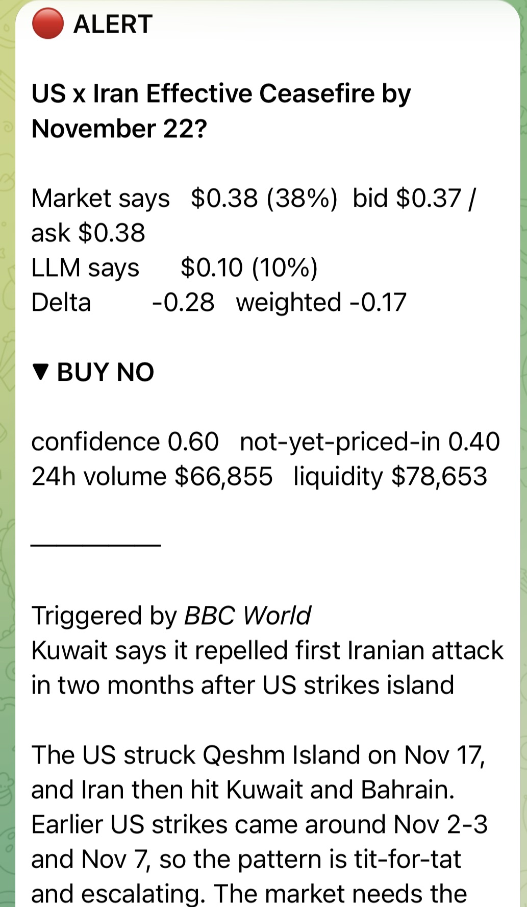
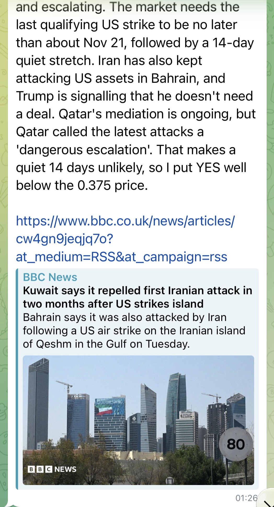
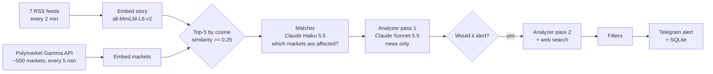
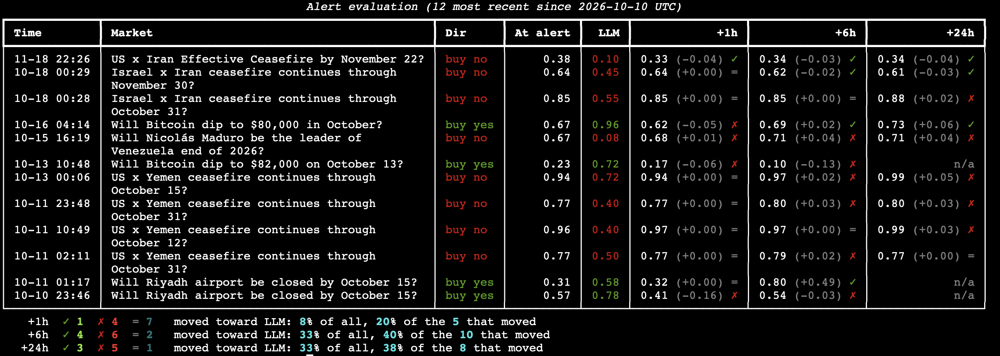
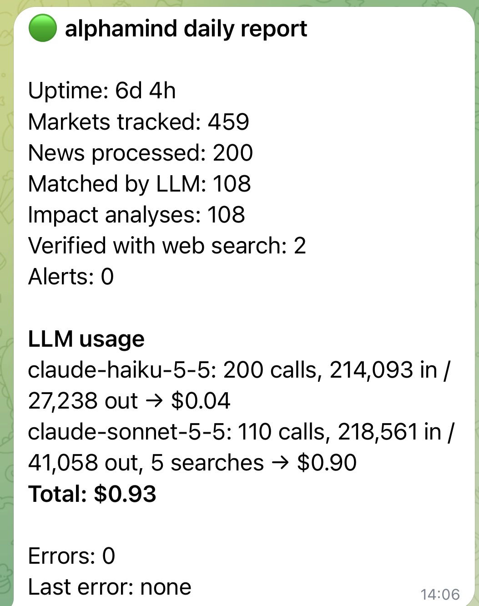
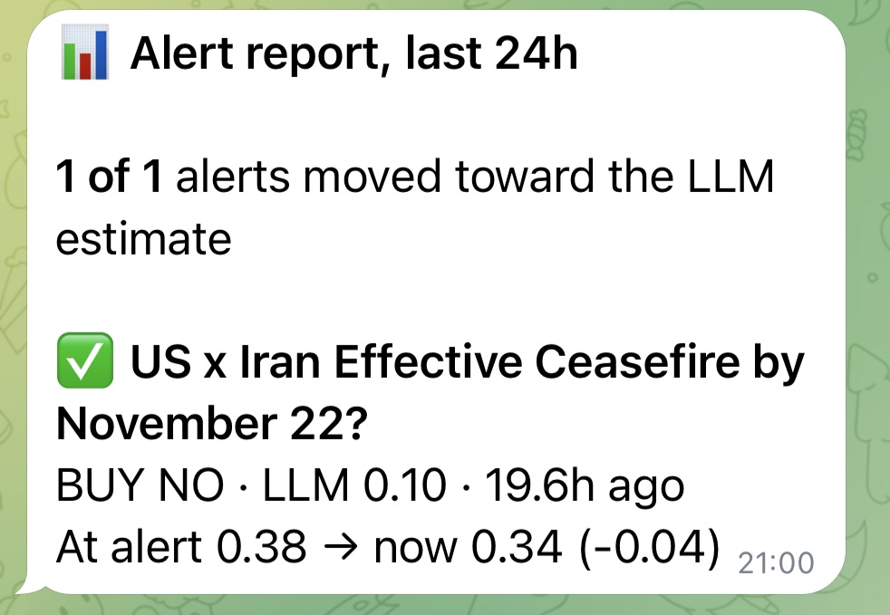

# alphamind

**News-driven alert system for prediction markets.** alphamind watches news feeds and Polymarket in real time, uses embeddings and LLMs to decide which markets a story affects and whether the price has caught up, and sends an alert to Telegram when it thinks a market is mispriced.

It ran live on AWS from August to November 2026. The most useful thing it produced was not profit but a measured answer to the question *"can an LLM reading the news beat a prediction market?"* (see [Results](#results)).

> [!WARNING]
> **Disclaimer.** alphamind is an experimental research and portfolio project. It is **not financial advice** and not a trading system: it only sends alerts, and its estimates are often wrong (see Results). Use it at your own risk. **The author accepts no responsibility or liability for any financial loss or other damage** arising from the use of this software or its output. Prediction markets may be restricted or prohibited where you live; check your local laws and Polymarket's terms before using it. This project is not affiliated with Polymarket or Anthropic. Provided "as is", without warranty of any kind (see [LICENSE](LICENSE)).

<p align="center">
  
  &nbsp;&nbsp;
  
</p>

---

## What it does

1. Polls 7 RSS feeds (BBC World, Al Jazeera, NYT World, NPR, CNBC Top, CNBC Economy, CoinDesk) every 2 minutes.
2. Tracks ~500 active Polymarket markets, refreshed every 5 minutes, and stores a price snapshot each time.
3. For every new story, finds candidate markets, asks an LLM which ones the story actually affects, and estimates what the YES probability should be now.
4. Alerts only when the estimate differs enough from the market price, the model is reasonably confident, and the market has likely not priced the news in yet.
5. Logs everything to SQLite so alerts can be scored against what the market did afterwards.

## How it works

The pipeline is a funnel: cheap filters first, expensive reasoning last.



**Retrieval (local, free).** Sentence embeddings narrow hundreds of markets to a handful of candidates in milliseconds. Embeddings are good at "same topic", bad at "actually affected": scores for related and unrelated markets often sat only a few hundredths apart, so they are used for recall, not for decisions.

**Matching (cheap LLM).** Haiku decides which candidates the story materially affects. The prompt explicitly rejects topic overlap and speculative causal chains, and treats "none" as the normal answer.

**Impact analysis (strong LLM).** Sonnet estimates the new YES probability, a confidence, and how likely it is that the market has not reacted yet. The prompt is structured against anchoring: reason from the news first, then treat the market price as informed evidence and only deviate when it can name information the market seems to lack.

**Two-pass verification.** The first pass sees only the news. Only if it would produce an alert does a second pass run with web search (up to 4 searches) to check the current state of the exact question the market resolves on. This keeps web search off the hot path and pays for it only where it matters. If the search itself fails, the model's confidence is capped at 0.3, so an unverified view cannot turn into an alert.

**Alert filters.** In order: pricing delay (skip news the market has likely priced in), confidence-weighted edge, re-alert check (a market that alerted in the last 24h only alerts again if the estimate moved by at least 0.15 or the direction flipped), and a deviation guard (estimates more than 0.40 away from the market are dropped, see Results for why).

**Cost controls.** A 3-hour per-market analysis cooldown stops the same event from being re-analyzed when several outlets report it. In the final configuration a typical day cost about **$0.93** in API fees (Haiku $0.04, Sonnet $0.90).

## Results

I scored every alert by whether the market price moved toward the LLM's estimate 1, 6 and 24 hours later.

### Version 1: 49 alerts (Aug 23 – Oct 18, 2026)

Counting only alerts where the price actually moved:

| Horizon | Toward LLM | Against | Hit rate |
|---|---|---|---|
| +1h | 9 | 14 | 39% |
| +6h | 17 | 17 | 50% |
| +24h | 8 | 16 | 33% |

No better than a coin flip, and worse at 24 hours. Reading the alerts one by one showed three failure patterns:

1. **Extreme disagreements were almost always wrong.** When the model said 0.90+ against a market at 0.08 (or similar), it had usually misread the news or what the market question asks. The market was right.
2. **Repeats.** One market produced 10 alerts with the same view, each a separate paid analysis.
3. **No view of the present.** The model judged single headlines without knowing the current state of the world, and leaned towards predicting dramatic change (e.g. ceasefires collapsing) far more than the market did.

An earlier lesson from the same data: the original score multiplied delta × confidence × pricing delay. With all three typically between 0.2 and 0.6, the product lived in a 0.01–0.05 band, so the 0.10 threshold was mathematically unreachable and a week of live running produced zero alerts. Pricing delay became a gate instead of a multiplier.

### Version 2: web search and filters (Oct 21 – Nov 25, 2026)

Changes: two-pass analyzer with web search, deviation guard, re-alert check, analysis cooldown, market resolution text in the prompts, newer models.

The filters did what they were designed to do: false positives largely disappeared. On a typical day the system processed ~200 stories, ran ~108 impact analyses, escalated 2 to web search, and sent **0 alerts**. Over five weeks it sent **one** alert, which moved toward the estimate at all three horizons (0.38 → 0.33 / 0.34 / 0.34).

<p align="center">
  
</p>

One alert is not evidence of anything. The honest conclusion is that version 2 traded volume for precision, and it ran too briefly to show whether any edge exists.

### What I took away

- **Speed is the real bottleneck.** RSS surfaces stories minutes after they break. The model's own pricing-delay estimate had a median of 0.2: by the time the system saw most stories, the market had already moved. Better prompts do not fix a latency problem.
- **More context pulls the model toward the market.** Web search removed the wild misreadings, but everything the model can look up, traders already know. Context reduces false alerts more than it creates real ones.
- **Measure before scaling.** Two months of logged alerts answered questions that no amount of prompt tuning on single examples could.

## Monitoring

Two reports go to Telegram every day: a health report at 11:06 UTC (uptime, throughput, per-model token usage and cost, errors) and, at 18:00 UTC, a report of how the last 24 hours of alerts have played out at +1h / +6h / +24h. The evening report is skipped on days without alerts.

<p align="center">
  
  &nbsp;&nbsp;
  
</p>

## Tech stack

Python · asyncio · sentence-transformers (all-MiniLM-L6-v2) · Anthropic API (Claude Haiku 5.5, Claude Sonnet 5.5, web search tool) · SQLite · feedparser · rich · Telegram Bot API · AWS EC2 · systemd · AWS Systems Manager

## Project structure

```
main.py              async loop: market refresh, news polling, cooldowns, daily reports
config.py            models, prices, thresholds, intervals
llm_utils.py         Anthropic client, JSON parsing, token usage and cost
alerts.py            alert filters, re-alert check, terminal display
notifier.py          Telegram alerts and reports
storage.py           SQLite: alerts and market price history
analyze.py           CLI: scores all past alerts against later prices
evaluation.py        alert scoring at +1h/+6h/+24h, builds the evening report
fetchers/
  polymarket.py      Gamma API, pagination, single-market lookup
  news.py            RSS aggregation and deduplication
matcher/
  embedder.py        sentence embeddings (lazy-loaded)
  candidates.py      vectorized cosine similarity, top-k
  llm_matcher.py     LLM relevance check
analyzer/
  impact.py          two-pass impact analysis with web search
```

## Setup

Requires Python 3.10+ (developed on 3.13).

```bash
git clone https://github.com/ardakrg/alphamind.git
cd alphamind
python3 -m venv venv
source venv/bin/activate
pip install -r requirements.txt
cp .env.example .env
```

Fill in `.env`:

```
ANTHROPIC_API_KEY=...
TELEGRAM_BOT_TOKEN=...
TELEGRAM_CHAT_ID=...
```

Telegram is optional; without it alerts only go to the terminal and the database.

Run:

```bash
python main.py
```

Modules in subfolders import `config.py` from the root, so run their test blocks as modules from the project root, e.g. `python -m analyzer.impact`.

Score past alerts:

```bash
python analyze.py                     # last 100 alerts
python analyze.py 20                  # last 20 alerts
python analyze.py --since 2026-10-21  # alerts on or after a date (UTC)
python analyze.py --db other.db       # read a different database
```

Preview the evening report in the terminal, or send it:

```bash
python evaluation.py          # dry run
python evaluation.py --send   # send to Telegram
```

**Notes**
- Polymarket is not reachable from some countries. The server needs direct access to `gamma-api.polymarket.com`.
- On macOS with the python.org installer, run `Install Certificates.command` once, otherwise HTTPS requests fail with a certificate error.
- On small servers, `/tmp` may be a RAM-backed tmpfs that is too small for PyTorch's wheel. Install the CPU-only build with a different temp dir: `TMPDIR=~/pip-tmp pip install torch --index-url https://download.pytorch.org/whl/cpu`.

## Deployment

It ran on an AWS EC2 t3.micro (1 GB RAM + 2 GB swap) as a systemd service with `Restart=always` and `PYTHONUNBUFFERED=1`. The instance had **no open inbound ports**: access was through AWS Systems Manager Session Manager, with a least-privilege IAM user that could only open sessions to that one instance.

## Configuration

Main thresholds in `config.py`:

| Setting | Default | Purpose |
|---|---|---|
| `MIN_SIMILARITY` | 0.25 | minimum cosine similarity for a candidate market |
| `TOP_K_CANDIDATES` | 5 | candidates sent to the matcher |
| `MIN_PRICING_DELAY` | 0.4 | skip news the market has likely priced in |
| `MIN_DELTA` | 0.10 | minimum confidence-weighted edge |
| `MAX_DELTA` | 0.40 | drop estimates this far from the market |
| `REALERT_MIN_CHANGE` | 0.15 | change needed to re-alert within 24h |
| `ANALYSIS_COOLDOWN_HOURS` | 3 | per-market analysis cooldown |
| `WEB_SEARCH_MAX_USES` | 4 | searches per verification pass |
| `SEARCH_FAILED_MAX_CONFIDENCE` | 0.3 | confidence cap when web search fails |
| `NEWS_CHECK_INTERVAL` | 120 s | RSS polling interval |
| `MARKET_REFRESH_INTERVAL` | 300 s | market refresh and price snapshot interval |
| `MARKET_FETCH_LIMIT` | 500 | markets tracked, by 24h volume |

Models are set with `MATCHER_MODEL` and `ANALYZER_MODEL`; `MODEL_PRICES` holds the per-token prices used for the daily cost line.

## License

MIT. See [LICENSE](LICENSE).